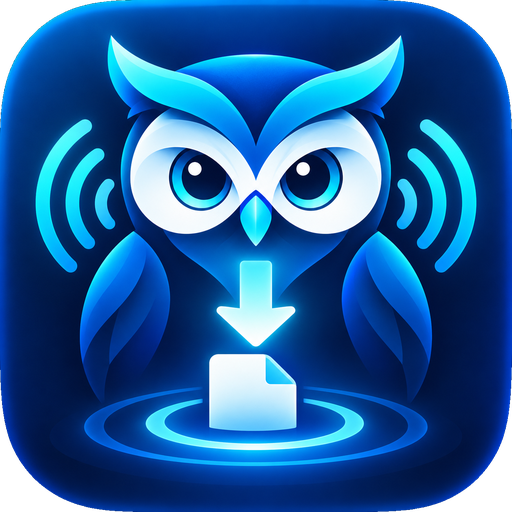
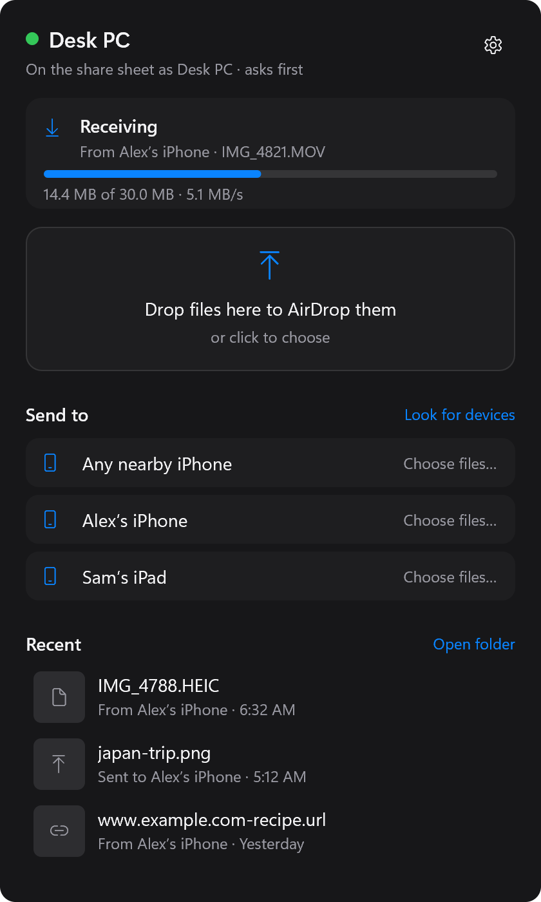
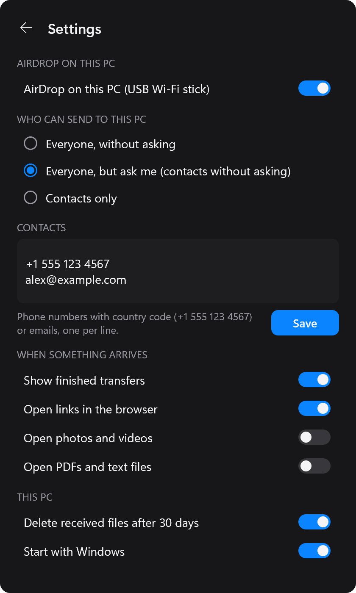
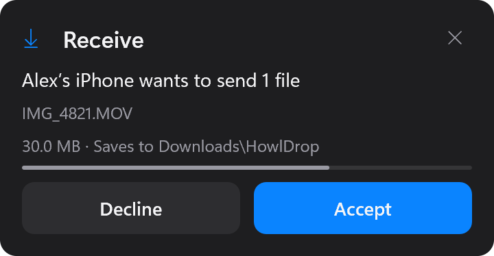
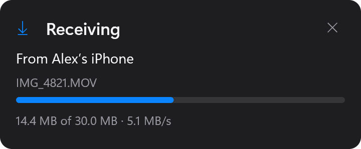

# howl-drop

AirDrop between an iPhone and a Windows PC. **HowlDrop** puts the PC on the
iPhone's share sheet: photos, videos, files and links land in
`Downloads\HowlDrop` with a notification, shared text goes on the clipboard,
and **Send to iPhone** (the tray menu, or Explorer's Send to) AirDrops files
back to the phone.

All it takes is `howldrop.exe` and a USB Wi-Fi stick with a MediaTek
**MT7612U** (e.g. Alfa AWUS036ACM, Netgear A6210; a Realtek RTL8852BU runs
too, untested). No Mac, no Home Assistant, nothing on the phone. **[Which Wi-Fi adapter?](../docs/adapters.md)** lists what works, what
might, and what can't (your PC's built-in Wi-Fi can't, on Windows).

<p align="center">
  
  &nbsp;
  
</p>
<p align="center">
  
  &nbsp;
  
</p>

```
iPhone ──AWDL (Wi-Fi) + BLE──▶ USB MT7612U ──WinUSB──▶ howldrop-agent.exe: the stick driven from user
                                                          │  space, Owly's AWDL and AirDrop receiver and
                                                          │  sender, a Wintun adapter as the link
                                                          ▼
                                howldrop.exe: tray, notifications, Downloads\HowlDrop, clipboard,
                                Send to iPhone, the Bluetooth wake from Windows' own Bluetooth
```

## Windows

1. Download `howldrop.exe` from
   [Releases](https://github.com/MrSco/howl-drop/releases/latest) and put it
   somewhere it can stay (say `%LOCALAPPDATA%\Programs\HowlDrop`). Nothing to
   install. Windows SmartScreen may not recognize it (it is not code-signed):
   **More info**, **Run anyway**.
2. Plug in the stick (a USB 2.0 port worked best), start `howldrop.exe`,
   right-click its icon by the clock, and turn on **AirDrop on this PC**.

The first time, HowlDrop downloads its agent (about 8 MB, from the same
release, checked against the SHA-256 built into the exe), and Windows asks
once to let it set itself up: into Program Files, as a scheduled task that
starts it without asking from then on, with the stick on Windows' own WinUSB
driver. The dot on the icon then turns green: the PC is on the share sheet
under its own name. No WSL, no extra drivers to find.

Click the tray icon for the HowlDrop window: drop files on it and pick the
phone to AirDrop them (set the iPhone's AirDrop to **Everyone for 10
Minutes**, then accept on the phone), and see what came and went. The PC's
Bluetooth wakes the phone; whatever else is connected to it stays connected.
Each transfer shows as a card by the tray, or in the window while it's
open: an incoming one asks first (unless the sender is one of your
contacts, or you let everyone through), then shows its progress.

The tray app, its menu, the commands and how it works:
[howldrop/README.md](../howldrop/README.md).

## Home Assistant, Raspberry Pi and Linux

The same agent also runs as a Home Assistant add-on, for a home server
that holds the stick instead of the PC: whatever the phone sends lands in
Home Assistant's share folder, where any PC on the network can open it, and a
PC running `howldrop.exe` also gets each file (the add-on's `forward_to_pc`,
paired with the tray's key) and can send to the phone through it.

[](https://my.home-assistant.io/redirect/supervisor_add_addon_repository/?repository_url=https%3A%2F%2Fgithub.com%2FMrSco%2Fhowl-drop%23ha-addon)

Or in Home Assistant: Settings, Add-ons, Add-on store, menu, Repositories,
and add `https://github.com/MrSco/howl-drop#ha-addon`. Then install HowlDrop,
turn Protection mode off, and start it. Requirements and options:
[addon/DOCS.md](../addon/DOCS.md). Home Assistant OS on a Raspberry Pi 3, 4 or 5
works the same way. Without Home Assistant OS, on Raspberry Pi OS (64-bit) or
another Linux, the same image runs under Docker Compose:
[docker/README.md](../docker/README.md).

There the radio can be any Wi-Fi card [Owly](https://github.com/t4t5/owly)'s
driver table supports (`crates/owly-radio/drivers.toml`), driven by the
host's own kernel driver. A card that is not the machine's network uplink
runs exclusive or active-monitor mode for as long as the add-on runs; one
that is the uplink can run shared mode. The MT7612U is the tested choice: it
follows the iPhone onto 5 GHz, where transfers run. See
[Which Wi-Fi adapter?](../docs/adapters.md) and
[docs/hardware-notes.md](../docs/hardware-notes.md).

The `ha-addon` branch is the add-on assembled from `main` by CI
(`tools/publish-addon.sh`), since Home Assistant builds an add-on only from its
own folder. It points Home Assistant at prebuilt images,
`ghcr.io/mrsco/howldrop-amd64` and `-aarch64`, which CI builds for each new
version in `addon/config.yaml` before it updates the branch: bump the version
to release a change.

This is a fork of [t4t5/owly](https://github.com/t4t5/owly) (formerly
omdrop-owl), AirDrop for Linux in Rust. Owly's crates are here as upstream
has them, plus a few patches of ours; HowlDrop adds `howldrop-agent`, the
Windows app, the add-on and delivery. [docs/fork.md](../docs/fork.md) lists
the patches and how to take in a new Owly.

## Layout

| Path | What |
|---|---|
| `howldrop/` | `howldrop.exe` (the Windows app: tray, AirDrop on this PC through the agent, the Bluetooth wake) and `howldrop-bridge` (the add-on's forwarder and relay), C++17, one CMake tree. |
| `crates/howldrop-agent/` | HowlDrop's radio side in one Rust process, on Linux (the add-on) and Windows: the radio, the AirDrop receiver (who can send, asks, progress) and sender (the outbox, previews), the events howldrop.exe reads; on Windows its one-time setup too. |
| `crates/mt7612u/` | The MT7612U driven from user space over USB (WinUSB on Windows), ported from Linux's mt76: firmware, channel, frames in and out, Block Ack ([docs/native-windows.md](../docs/native-windows.md)). |
| `crates/owly-*`, `owlyd`, `xtask`, `packaging/`, `docs/SPEC.md` … | [Owly](https://github.com/t4t5/owly), as upstream has it, with our patches ([docs/fork.md](../docs/fork.md)). |
| `addon/` | The Home Assistant add-on's image: `config.yaml`, `Dockerfile` (builds the agent), `run.sh` (options to the agent), delivery (`deliver.py`, `announce.py`) and the sidebar panel (`panel.py`, `panel/`). |
| `docker/` | The same image under Docker Compose, without Home Assistant OS: `compose.yaml`, default `options.json`, `install.sh`. |
| `tools/` | `stage-addon.sh` assembles the add-on folder; `build-howldrop.ps1` builds `howldrop.exe`; `sync-upstream.sh` takes in a new Owly; `make-icons.py` makes the icons from `art/howldrop.png`. |
| `tests/test_*.py` | Delivery, the panel and the Docker install, against local files and sockets: no radio needed. (The rest of `tests/` is Owly's.) The Rust crates' tests are in each crate; `howldrop/tests/` has the Windows app's. |

## Develop

`howldrop.exe` builds with CMake, Ninja and a MinGW-w64 g++ (Strawberry Perl
ships all three), and CI builds it on every push:

```powershell
tools\build-howldrop.ps1 -Run
```

A local build has no agent to download: put `howldrop-agent.exe` and
`howldrop-agentw.exe` (`cargo build --release -p howldrop-agent`),
WireGuard's `wintun.dll` and a `firmware` folder with the stick's two files
beside it ([docs/native-windows.md](../docs/native-windows.md)). Releasing is
in [howldrop/README.md](../howldrop/README.md): set the version, then push a
`windows-vVERSION` tag.

The Rust and Python tests (the agent's Windows parts on Windows, the rest on
either):

```bash
cargo test --workspace
python3 -m unittest discover -s tests
```

The add-on image builds the agent itself (`addon/Dockerfile`), so Docker is
all a build of the image needs. To try an add-on
change on Home Assistant before pushing it, stage it into Home Assistant's
`/addons` share and bump `version` in `addon/config.yaml` for every deploy, or
Supervisor keeps the old image:

```bash
tools/stage-addon.sh //homeassistant/addons/howldrop
```

In Home Assistant: Add-on store, menu, Check for updates, update HowlDrop,
start it, and read its log. That's the local add-on (`local_howldrop`);
pushing to `main` publishes it to the `ha-addon` branch once CI passes.

What runs in the image is Rust, Linux shell and Python, so `.gitattributes`
keeps the checkout LF even with `core.autocrlf`; `stage-addon.sh` refuses a
CRLF file.
