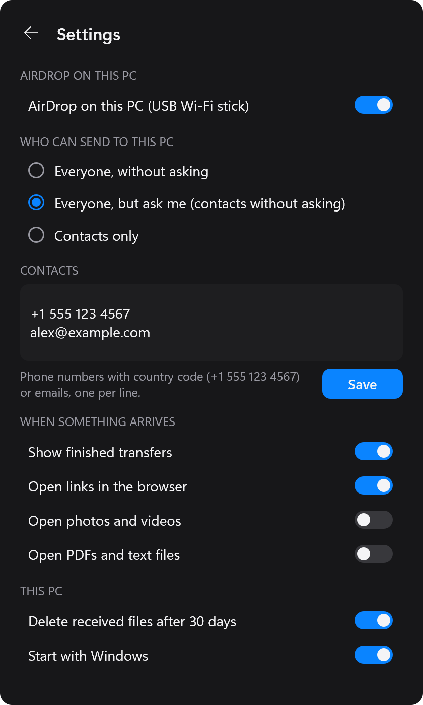
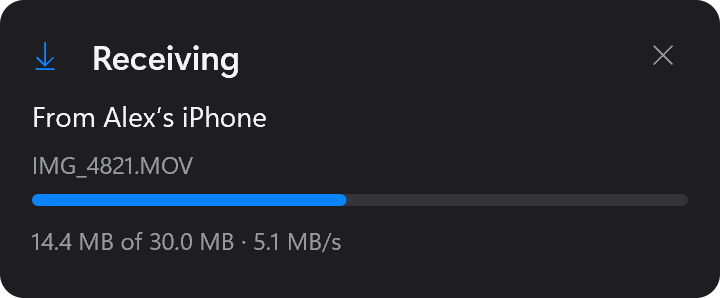

# howl-drop

AirDrop between an iPhone and a Windows PC. **HowlDrop** puts the PC on the
iPhone's share sheet: photos, videos, files and links land in
`Downloads\HowlDrop` with a notification, shared text goes on the clipboard,
and **Send to iPhone** (the tray menu, or Explorer's Send to) AirDrops files
back to the phone.

All it takes is `howldrop.exe` and a USB Wi-Fi stick with a MediaTek
**MT7612U** (e.g. Alfa AWUS036ACM). No Mac, no Home Assistant, nothing on the
phone.

<p align="center">
  
  &nbsp;
  
</p>
<p align="center">
  
  &nbsp;
  
</p>

```
iPhone ──AWDL (Wi-Fi) + BLE──▶ USB MT7612U ──usbipd──▶ WSL 2: OWL, AirDrop receiver and sender
                                                          │  (a distro howldrop.exe downloads and runs)
                                                          ▼
                                howldrop.exe: tray, notifications, Downloads\HowlDrop, clipboard,
                                Send to iPhone, the Bluetooth wake from Windows' own Bluetooth
```

## Windows

1. Download `howldrop.exe` from
   [Releases](https://github.com/MrSco/howl-drop/releases/latest) and put it
   somewhere it can stay (say `%LOCALAPPDATA%\Programs\HowlDrop`). Nothing to
   install. Windows SmartScreen may not recognize it (it is not code-signed):
   **More info**, **Run anyway**.
2. Have WSL 2: in an administrator terminal, `wsl --install`, then restart.
3. Plug in the stick (a USB 2.0 port worked best), start `howldrop.exe`,
   right-click its icon by the clock, and turn on **AirDrop on this PC**.

The first time, HowlDrop offers to install
[usbipd-win](https://github.com/dorssel/usbipd-win) (which hands the stick to
WSL), downloads its Linux part (about 250 MB, from the same release, checked
against the SHA-256 built into the exe), and Windows asks once to share the
stick. The dot on the icon then turns green: the PC is on the share sheet
under its own name.

Click the tray icon for the HowlDrop window: drop files on it and pick the
phone to AirDrop them (set the iPhone's AirDrop to **Everyone for 10
Minutes**, then accept on the phone), and see what came and went. The PC's
Bluetooth wakes the phone; whatever else is connected to it stays connected.
Each transfer shows as a card by the tray, or in the window while it's
open: an incoming one asks first (unless the sender is one of your
contacts, or you let everyone through), then shows its progress.

The tray app, its menu, the commands and how it works:
[howldrop/README.md](howldrop/README.md).

## Home Assistant, Raspberry Pi and Linux

The same radio stack also runs as a Home Assistant add-on, for a home server
that holds the stick instead of the PC: whatever the phone sends lands in
Home Assistant's share folder, where any PC on the network can open it, and a
PC running `howldrop.exe` also gets each file (the add-on's `forward_to_pc`,
paired with the tray's key) and can send to the phone through it.

[](https://my.home-assistant.io/redirect/supervisor_add_addon_repository/?repository_url=https%3A%2F%2Fgithub.com%2FMrSco%2Fhowl-drop%23ha-addon)

Or in Home Assistant: Settings, Add-ons, Add-on store, menu, Repositories,
and add `https://github.com/MrSco/howl-drop#ha-addon`. Then install HowlDrop,
turn Protection mode off, and start it. Requirements and options:
[addon/DOCS.md](addon/DOCS.md). Home Assistant OS on a Raspberry Pi 3, 4 or 5
works the same way. Without Home Assistant OS, on Raspberry Pi OS (64-bit) or
another Linux, the same image runs under Docker Compose:
[docker/README.md](docker/README.md).

There the radio can be any Wi-Fi card
[omdrop-owl](https://github.com/t4t5/omdrop-owl) has a profile for
(`userspace/owl-profiles`), driven by the host's own kernel driver. A card
that is not the machine's network uplink runs exclusive mode for as long as
the add-on runs; one that is the uplink can run shared mode. The MT7612U is
the tested choice: it follows the iPhone onto 5 GHz, where transfers run. See
[docs/hardware-notes.md](docs/hardware-notes.md).

The `ha-addon` branch is the add-on assembled from `main` by CI
(`tools/publish-addon.sh`), since Home Assistant builds an add-on only from its
own folder. It points Home Assistant at prebuilt images,
`ghcr.io/mrsco/howldrop-amd64` and `-aarch64`, which CI builds for each new
version in `addon/config.yaml` before it updates the branch: bump the version
to release a change. The amd64 image is also the Windows version's Linux part
(`tools/wsl-distro`).

This is a fork of [t4t5/omdrop-owl](https://github.com/t4t5/omdrop-owl), the
Linux radio backend for [omdrop](https://github.com/netmojo-systems/omdrop-plugin),
with the Windows app, the add-on and delivery added, and its distribution
packaging removed (upstream has it).

## Layout

| Path | What |
|---|---|
| `howldrop/` | `howldrop.exe` (the Windows app: tray, AirDrop on this PC in WSL, the Bluetooth wake) and `howldrop-bridge` (the add-on's forwarder and relay), C++17, one CMake tree. |
| `addon/` | The radio stack's image, as a Home Assistant add-on and as the Windows version's Linux part: `config.yaml`, `Dockerfile`, `run.sh`, `wsl-run.sh` (its start under howldrop.exe), and the Python it ships (`deliver.py`, `announce.py`, `outbox.py`, `senders.py`, `patch_receiver.py`), and the sidebar panel (`panel.py`, `panel/`). |
| `docker/` | The same image under Docker Compose, without Home Assistant OS: `compose.yaml`, default `options.json`, `install.sh`. |
| `userspace/` | `omdrop-discoverable`, the radio helper, and `owl-profiles`, its per-driver table. |
| `patches/`, `pins` | OWL's pinned upstream commit and the patches applied to it; `tools/build-owl.sh` applies them. |
| `tools/` | `build-owl.sh` and `stage.sh` build the radio stack (inside the image); `stage-addon.sh` assembles the add-on folder; `wsl-distro/` makes the Windows version's WSL distro from the image; `build-howldrop.ps1` builds `howldrop.exe`; `make-icons.py` makes the icons from `art/howldrop.png`. |
| `tests/` | The helper, the add-on's radio choice, delivery, sending and the allow list, against command doubles and local sockets: no radio needed. `howldrop/tests/` has the Windows app's. |

## Develop

`howldrop.exe` builds with CMake, Ninja and a MinGW-w64 g++ (Strawberry Perl
ships all three), and CI builds it on every push:

```powershell
tools\build-howldrop.ps1 -Run
```

A local build has no Linux part to download: it runs a `HowlDrop` WSL distro
already imported (a release's). Releasing is in
[howldrop/README.md](howldrop/README.md): push the version to `main`, then a
`windows-vVERSION` tag.

The radio stack's tests:

```bash
tools/run-tests.sh
```

(or `python -m unittest discover -s tests` without bats). To try an add-on
change on Home Assistant before pushing it, stage it into Home Assistant's
`/addons` share and bump `version` in `addon/config.yaml` for every deploy, or
Supervisor keeps the old image:

```bash
tools/stage-addon.sh //homeassistant/addons/howldrop
```

In Home Assistant: Add-on store, menu, Check for updates, update HowlDrop,
start it, and read its log. That's the local add-on (`local_howldrop`);
pushing to `main` publishes it to the `ha-addon` branch once CI passes.

What runs in the image is Linux shell and Python, so `.gitattributes` keeps
the checkout LF even with `core.autocrlf`; `stage-addon.sh` refuses a CRLF
file.
