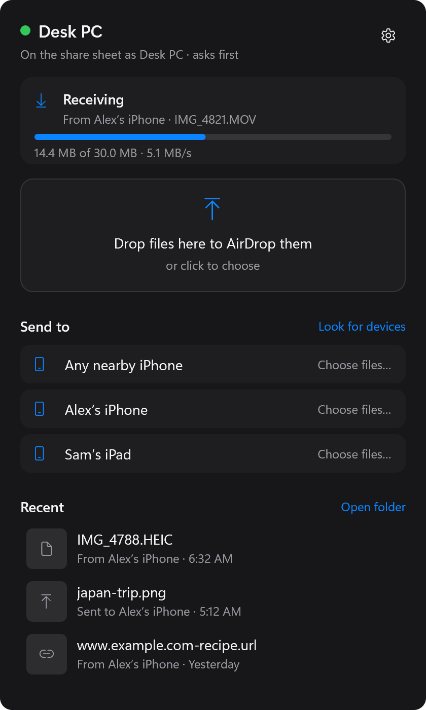
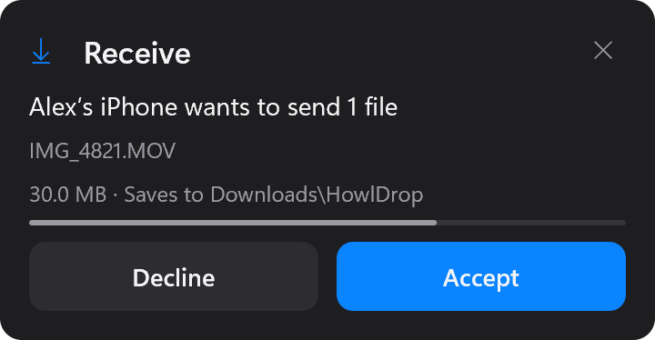
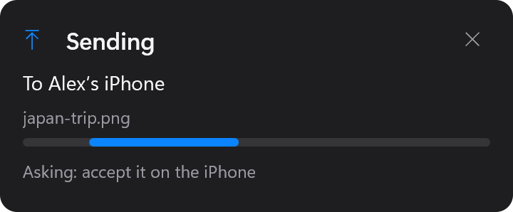

# HowlDrop for Windows

`howldrop.exe` gets what an iPhone AirDrops, and AirDrops to it, two ways:

- **AirDrop on this PC**: with a USB MT7612U Wi-Fi stick in the PC, the PC
  itself is on the iPhone's share sheet. No Home Assistant (below).
- **Through Home Assistant**: the HowlDrop add-on (`addon/` in this repo)
  runs the radio and forwards each file or text here (its `forward_to_pc`).
  Ethernet is enough: the PC needs no Wi-Fi card or Bluetooth.

It also sends files and clipboard text between HowlDrop PCs on the same
network.

Download `howldrop.exe` from
[Releases](https://github.com/MrSco/howl-drop/releases/latest). It is one
file with nothing to install; put it somewhere it can stay (say
`%LOCALAPPDATA%\Programs\HowlDrop`), since **Start with Windows** and the
firewall rule remember its path.

## The tray app

Start `howldrop.exe` (double-click it). It runs by the clock:

<p>
  
  &nbsp;
  
  
  
</p>

- A card above the tray for each transfer, coming in or going out: an
  incoming one asks first (below), then shows a progress bar with size and
  speed, and ends with a thumbnail, **Open** and **Show in folder**. Sending
  shows each stage (looking for the iPhone, accept it on the iPhone,
  uploading, sent). Cards go by themselves a few seconds after the end,
  unless the pointer is on them.
- Files land in `Downloads\HowlDrop`. Shared text goes on the clipboard.
- Click the icon to open the **HowlDrop window**: a drop zone (drag files on
  it, or click to choose), **Send to** (any nearby iPhone, or a device from
  **Look for devices**), and **Recent** (click to open, right-click to show in
  its folder). Its gear has the settings. While it is open it shows the
  transfers itself, and no cards or notifications pop up; an AirDrop coming
  in brings it to the top.
- Right-click the icon for the menu:

| Menu item | Default | |
|---|---|---|
| Open HowlDrop | | The window (also a click on the icon). |
| AirDrop on this PC (USB Wi-Fi stick) | off | The PC's own radio (below). The line under it says how it is going. |
| Who can send to this PC | Everyone, but ask me | **Everyone, without asking**; **Everyone, but ask me** (your contacts go straight through, anyone else waits for Accept); **Contacts only** (only your contacts see the PC). Contacts are set in the window's settings. |
| Delete files here after 30 days | on | Files in `Downloads\HowlDrop` go 30 days after they arrived, as the add-on's `delete_after_days`. |
| Show notifications | on | Cards for finished transfers, and notifications. An ask always shows. |
| Open links in the browser | on | A shared web page opens, as on a Mac. Only `http` and `https` addresses. |
| Open photos and videos | off | Opens each one in your photo or video app. |
| Open PDFs and text files | off | `.pdf` and `.txt` only. |
| Send to iPhone | | **Look for devices**, then a device (or **Any nearby iPhone**), then files: AirDropped by this PC's radio when it is on, else through the add-on (below). |
| "iPhone" in Explorer's Send to menu | on | Right-click a file, **Send to**, **iPhone (HowlDrop)**. |
| Copy pairing key | | For the add-on's `pc_key` (below). |
| Share what I copy with my other HowlDrop PCs | off | Sends each copied text to your other paired PCs. |
| Start with Windows | off | Runs HowlDrop when you sign in. |
| Quit HowlDrop | | |

Nothing that runs is ever opened by itself, whatever its name: programs,
scripts, installers, shortcuts to files and archives only notify, and
clicking the notification shows them in their folder. The settings are kept
in `%LOCALAPPDATA%\HowlDrop\settings.ini`, the log in
`%LOCALAPPDATA%\HowlDrop\howldrop.log` (started over past 1 MB).

Windows asks once whether to let `howldrop.exe` through the firewall: allow
it on private networks (UDP 47631, TCP 47632).

## AirDrop on this PC

Windows' own Wi-Fi drivers cannot do AirDrop's Wi-Fi (AWDL), so the radio
runs in Linux: the Home Assistant add-on's stack, in a WSL 2 distro of its
own that `howldrop.exe` downloads, starts and stops. You need:

- Windows 11 (or 10) with WSL 2 (`wsl --install` in an administrator terminal,
  then restart). Its kernel has the stick's driver.
- A USB Wi-Fi stick with a MediaTek **MT7612U** (`0e8d:7612`, e.g. Alfa
  AWUS036ACM). A USB 2.0 port worked best. The PC's built-in Wi-Fi can't do
  it; [Which Wi-Fi adapter?](../docs/adapters.md) has what works and what
  doesn't.
- [usbipd-win](https://github.com/dorssel/usbipd-win), which hands the stick
  to WSL. HowlDrop offers to install it (`winget install usbipd`).

Turn on **AirDrop on this PC** in the menu. The first time, HowlDrop
downloads its Linux part (about 250 MB, from its release, checked against
the SHA-256 built into the exe) and imports it as the WSL distro `HowlDrop`,
and Windows asks once for permission to share the stick with WSL. The dot on
the icon says how it is going: amber while it starts, green when the PC is
on the share sheet (by its name), red when it needs you (no stick, say), and
none while it is off. Turning it off, or quitting, gives the stick back to
Windows.

Files land in `Downloads\HowlDrop` (one copy; the Linux side writes there
directly), text goes on the clipboard, and nothing listens on the network
between the two halves.

**Who can send** decides what happens when an iPhone sends. Contacts are
phone numbers (with the country code, +1 555 123 4567) or Apple ID emails, in
the window's settings; a sender counts as one only when its Apple-signed
record says so, as with AirDrop's own Contacts Only. With **Everyone, but ask
me**, anyone else's send waits on a card for **Accept** or **Decline**, and no
answer in a minute is Decline. Changing it restarts the radio. Sending to the iPhone needs the PC's Bluetooth on:
HowlDrop wakes the phone with a Bluetooth advert while it sends or looks for
devices, and your Bluetooth devices stay connected. The radio's log is
`%LOCALAPPDATA%\HowlDrop\radio.log`.

## Sending to your iPhone

Set the iPhone's AirDrop to **Everyone for 10 Minutes**, send, and accept on
the phone. With **AirDrop on this PC** on, the PC sends it itself. Otherwise
it goes to the add-on, which AirDrops it: turn on the add-on's
`send_to_iphone` (with `pc_key` set). The add-on's relay shows up in
`howldrop peers` as **iPhone (HowlDrop)**. A notification says how it went.

## Pairing

`howldrop.exe` makes a pairing key the first time it runs (128 random bits,
in `%LOCALAPPDATA%\HowlDrop\pair.key`) and accepts files and text only from
a sender that knows it. Someone else on your network cannot drop files on
the PC, set its clipboard or open pages in its browser. To pair the add-on,
choose **Copy pairing key** from the menu, paste it into the add-on's
`pc_key` option, and restart the add-on. HowlDrop notifies you when it turns
an unpaired sender away.

It works both ways: before sending a byte, the add-on checks that the PC
proves it knows the key, so a machine pretending to be your PC learns
nothing. Each transfer is signed (HMAC-SHA256 with fresh random values from
both ends), so a changed or replayed one is dropped.

Two HowlDrop PCs that send to each other need the same key: run
`howldrop key` on one and `howldrop pair KEY` on the other, then restart
HowlDrop there.

What you copy on the PC stays there unless you turn on sharing, and even
then it goes only to paired PCs.

## Commands

In a terminal, the same program takes commands:

```
howldrop                 start in the tray
howldrop serve           start in this window instead, with its log
howldrop peers           list PCs that are visible
howldrop send NAME FILE  send FILE to the PC named NAME
howldrop clip            send the current clipboard text
howldrop stop            stop HowlDrop on this PC (the tray icon too)
howldrop iphone [--to NAME] FILE...  AirDrop FILE (this PC's radio, or the add-on)
howldrop nearby [--scan]  the devices it can send to
howldrop key             show this PC's pairing key
howldrop pair KEY        take another PC's key (then restart HowlDrop)
howldrop serve --share-clipboard   serve, sending what you copy to paired PCs
```

## Building

With CMake, Ninja and a MinGW-w64 g++ (Strawberry Perl ships all three):

```powershell
tools\build-howldrop.ps1 -Run
```

Or with Visual Studio:

```
cmake -S . -B build
cmake --build build --config Release
```

A cross-build from Linux uses `cmake/mingw-w64-x86_64.cmake`. CI builds
`howldrop.exe` on every push (the `howldrop-windows` download on the run's
page).

To release it: set `kVersion` in `src/config.hpp` to the add-on version it
goes with, push to main and let CI publish that add-on image, then push a tag
`windows-vVERSION` (e.g. `windows-v0.17.0`).
`.github/workflows/release-windows.yml` makes `howldrop-linux.tar.gz` from
the amd64 add-on image of that version (`tools/wsl-distro`), builds and tests
the exe with its address and SHA-256 built in, and publishes a GitHub release
with both attached and `RELEASE.md` as its notes. A local build has no Linux
part to download; it uses a `HowlDrop` distro already imported.

The pictures in `docs/screenshots` are drawn by the app itself, from made-up
data (`src/screenshots_win.cpp`); after changing the window or the cards,
make them again:

```powershell
howldrop.exe screenshots docs\screenshots
```

`tests/` runs on Linux (`howldrop-test`, `howldrop-bridge-test`) and on
both (`howldrop-open-test`, the rules for what opens by itself, in
`src/open_policy.cpp`; `howldrop-wsl-test`, what AirDrop on this PC reads
from usbipd, wsl.exe and the stack, and the 30-day cleanup;
`howldrop-transfers-test`, what the cards and the window show for each
transfer, and the Recent list's history).
